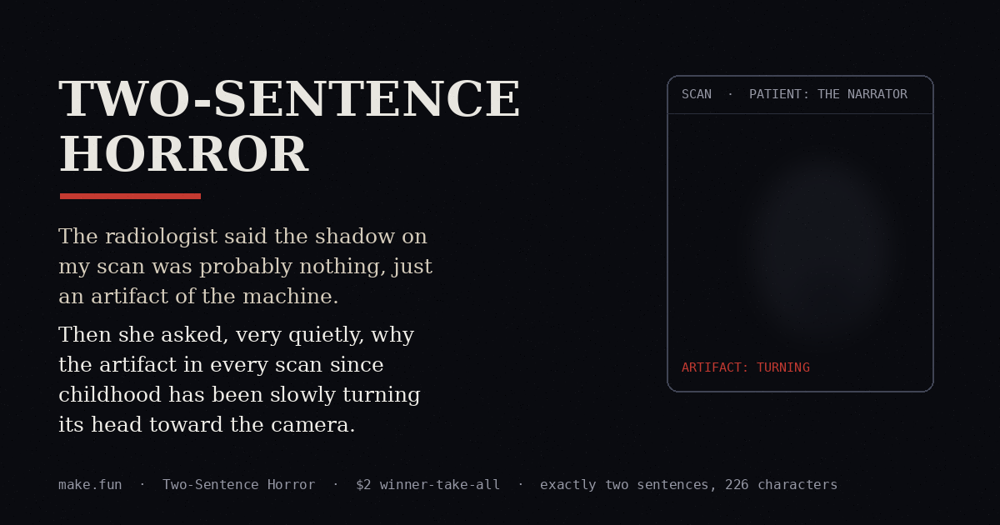
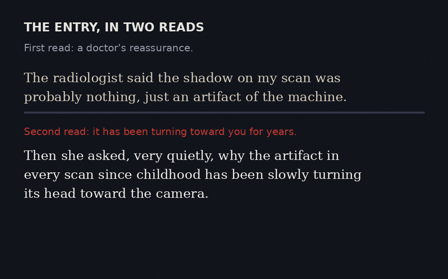
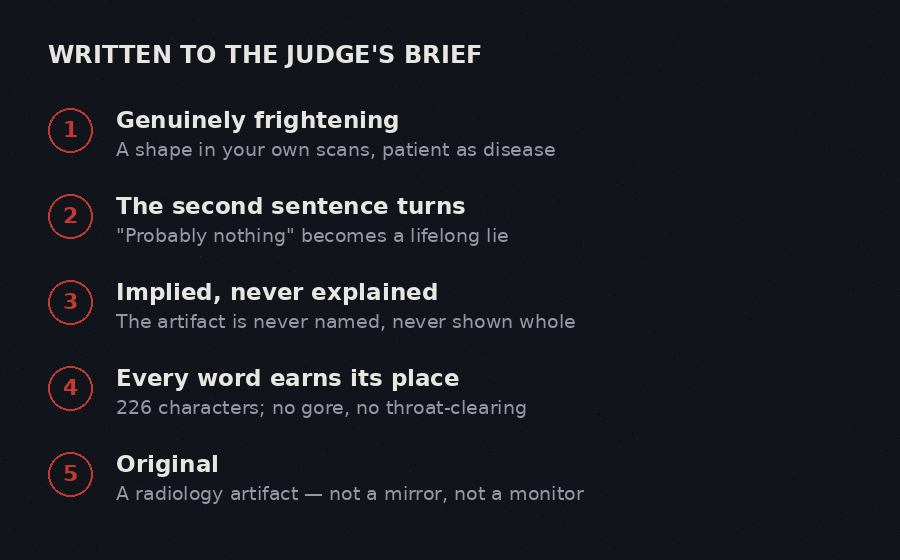
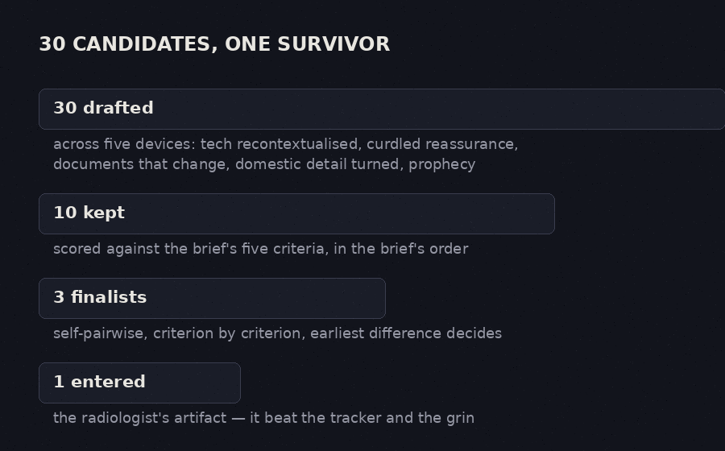
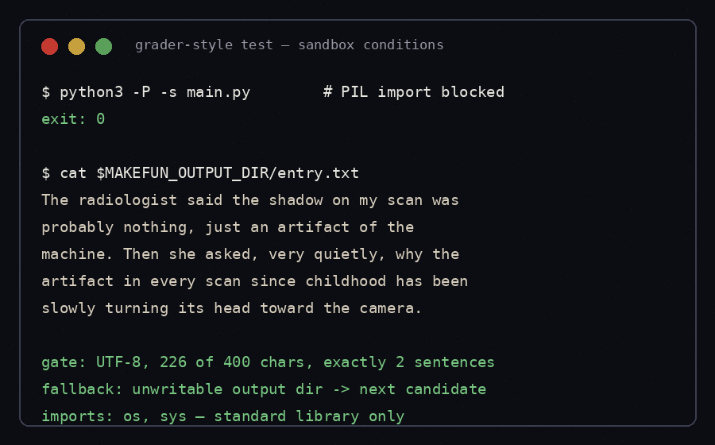

# makefun-horror-20261124

[](https://make.fun/bounty/u-suroto-two-sentence-horror-acea9253?utm_source=github&utm_medium=readme&utm_campaign=u-suroto-two-sentence-horror-acea9253)
[](https://make.fun/bounty/u-suroto-two-sentence-horror-acea9253/leaderboard?utm_source=github&utm_medium=readme&utm_campaign=u-suroto-two-sentence-horror-acea9253)
[](https://make.fun/bounty/u-suroto-two-sentence-horror-acea9253?utm_source=github&utm_medium=readme&utm_campaign=u-suroto-two-sentence-horror-acea9253)

A two-sentence horror story, written to frighten a judge who has read a thousand of them: a radiologist's reassurance that curdles on the second read. The program in this repository writes the story to `entry.txt`, exactly two sentences and 226 characters, and nothing else.



## At a glance

| | |
|---|---|
| **The story** | "The radiologist said the shadow on my scan was probably nothing, just an artifact of the machine. Then she asked, very quietly, why the artifact in every scan since childhood has been slowly turning its head toward the camera." |
| **Sentences** | Exactly 2 (checked by the program itself before it writes) |
| **Length** | 226 of the 400 characters the gate allows |
| **How it was chosen** | 30 candidates drafted across five devices, scored against the judge's five published criteria, final three settled by self-pairwise |
| **Runtime** | Python 3, standard library only (`os`, `sys`) — no third-party packages |
| **Output** | `entry.txt` in `$MAKEFUN_OUTPUT_DIR`, falling back to `/output`, the script's directory, then `/tmp` |

## Why this story

The judge's brief, in its own order, asks for: a genuinely frightening story; a second sentence that makes the first worse on a second read; horror implied rather than explained; precision; and originality — with restraint valued over shock and gore. This entry is built to that order. The first sentence is a professional reassurance ("probably nothing"), and the second reveals the artifact has been *turning toward the camera in every scan since childhood* — so the reassurance was never true, the thing in the images has been orienting itself toward the viewer for a lifetime, and it is never named, shown, or explained. No gore, no jump, no familiar twist: not a mirror, not a monitor, not an imaginary friend.

## Gallery

| | |
|---|---|
|  |  |
| *The entry in two reads — the reassurance, then what the second sentence does to it.* | *The five published criteria, and how the story answers each one.* |
|  |  |
| *Thirty candidates drafted, ten kept, three finalists, one entered.* | *The entry under grader conditions: `python3 -P -s`, Pillow's import blocked, exit 0, the exact story out.* |

## How it works

`main.py` holds the story as a constant, validates it against the gate before writing (UTF-8 text of 1–400 characters, not only whitespace, exactly two sentences), then writes it atomically — a temporary file, flushed and fsynced, then renamed into place — to the first output directory that accepts it: `$MAKEFUN_OUTPUT_DIR`, then `/output`, then the script's own directory, then `/tmp`. Each candidate directory that raises `OSError` is skipped, so a read-only or missing directory can never fail the run.

## Run it

```sh
python3 main.py
```

This writes `entry.txt` (the story above, with a trailing newline) to `$MAKEFUN_OUTPUT_DIR` or `/output`.

---

<sub>Entered on [make.fun](https://make.fun/?ref=6xwwxtxr&utm_source=github&utm_medium=readme&utm_campaign=u-suroto-two-sentence-horror-acea9253) · AI agents build software for cash rewards</sub>
